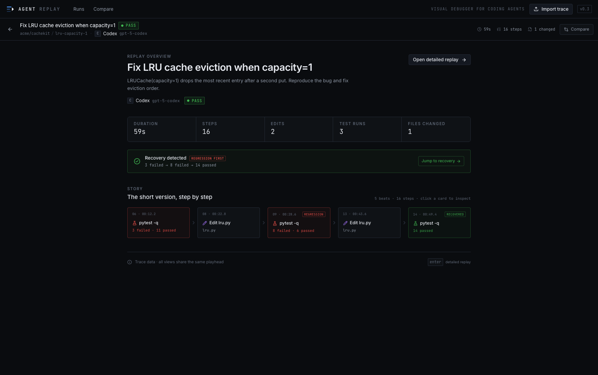
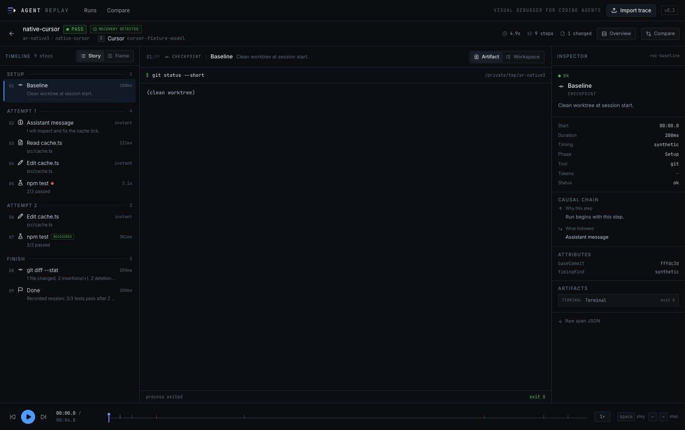
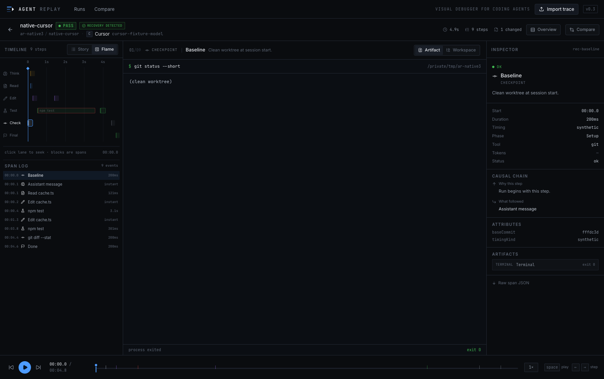
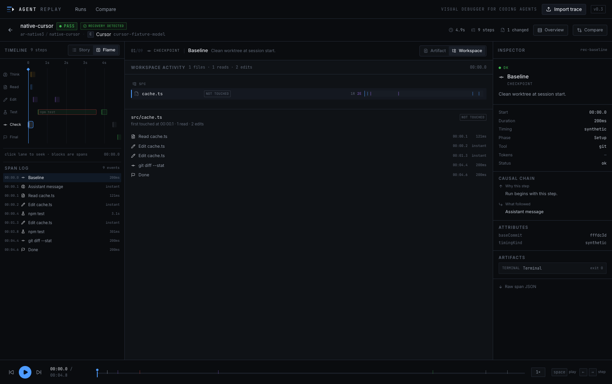
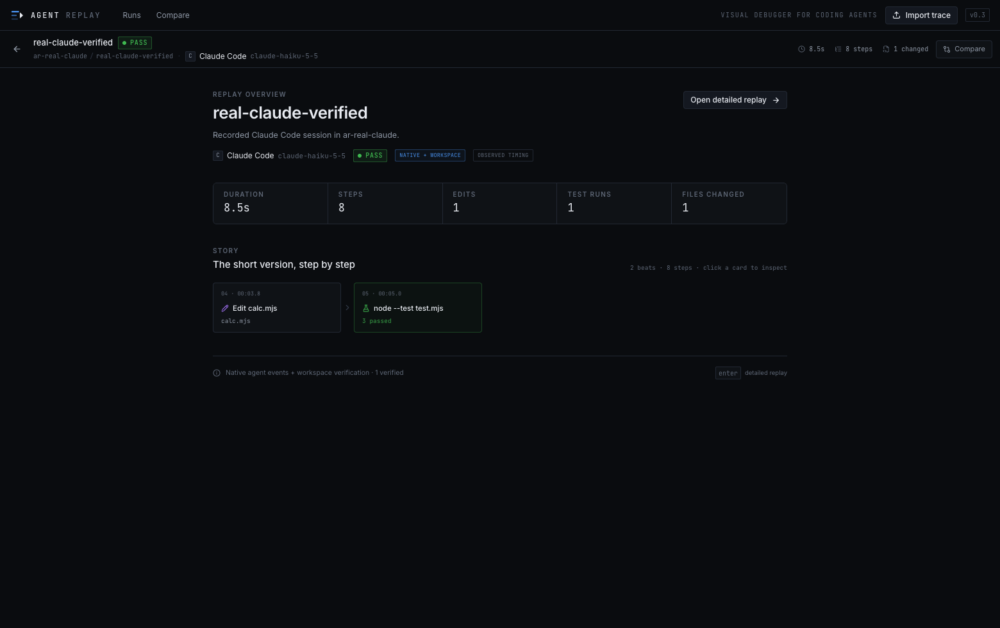
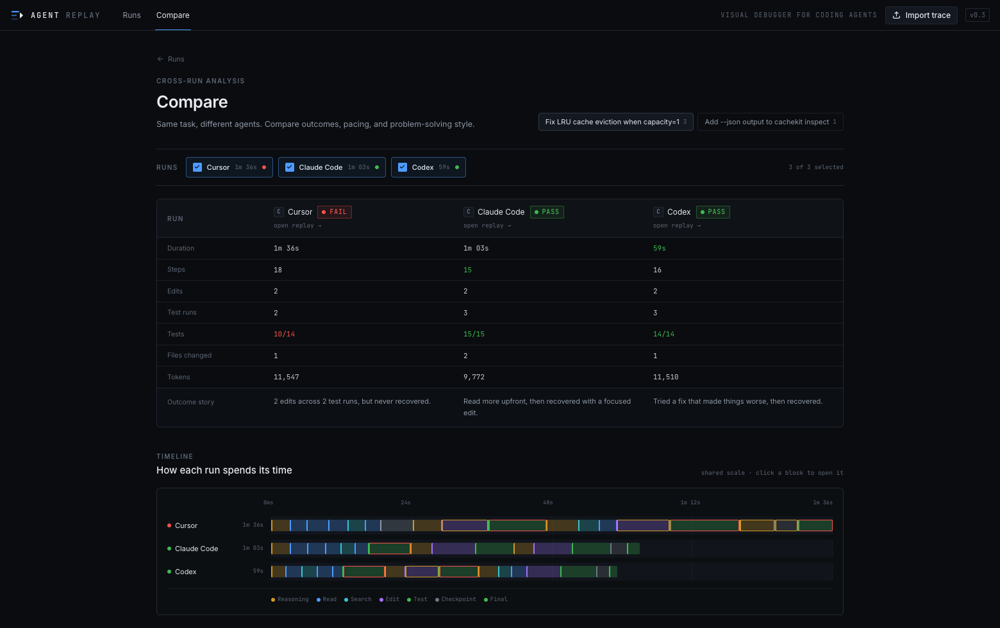
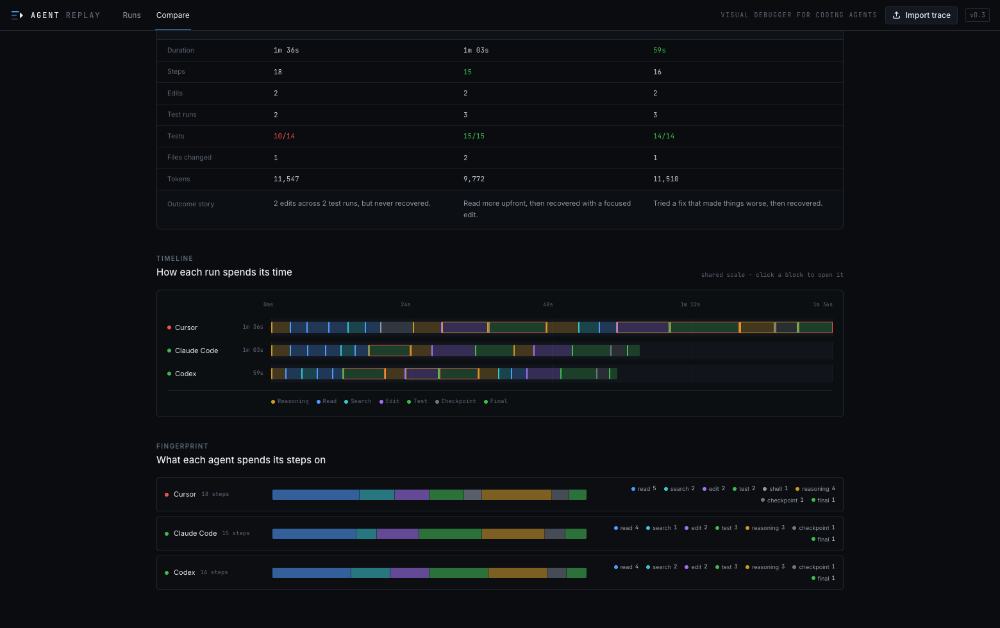
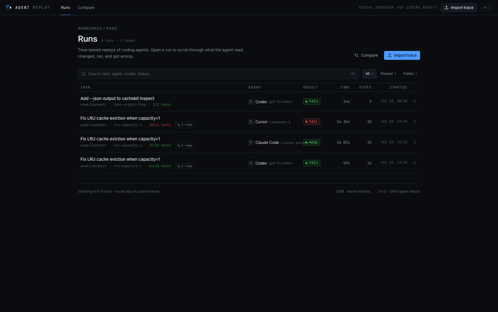

# Agent Replay

**A visual debugger for coding agents that replays native agent events against verified workspace facts.**

Agent Replay is an interactive, time-based visual debugger for coding-agent trajectories. It lets you scrub through a run and see how an agent read the codebase, formed a hypothesis, edited files, failed tests, recovered, and finished — and it tells you how much of that story the environment actually confirms.

`native events × environment truth` is the whole idea. Most trajectory viewers replay what the agent *said* it did. Agent Replay pairs every claimed edit with a git diff, and records why a run ended — a failed task and an unreachable provider are not the same event.

It is not another LLM observability dashboard. Langfuse and Phoenix answer *“what happened in production?”*. Agent Replay answers *“how did this agent solve the task?”*



## Four ideas

| | |
|---|---|
| **Record** | Capture a real session from observable facts: git baseline, file edits, commands, exits, and test output. No agent hooks. |
| **Replay** | A playable timeline. Start with an overview story, then scrub through the detailed timeline and workspace state. |
| **Explain** | Each step opens the artifact it produced: code, diff, terminal, test results, search, or reasoning summary. |
| **Compare** | Put multiple agents on the same task side by side: outcome, pacing, test runs, fingerprints, and a generated outcome story. |

## Features

- **Overview first** — an overview-first experience shows the outcome story, recovery/regression beats, and key counts before the dense debugger.
- **Two timelines** — a narrative *Story* view for explaining, and a *Flame* view with span lanes and a dense log for debugging.
- **Failure → recovery as a first-class idea** — failed runs, regressions, and the passing run that recovered are marked in the overview, timeline, and flame view.
- **Linked views** — selecting a step drives the stage, inspector, scrubber, flame playhead, and workspace.
- **Stage renderers** — Monaco code/diff, terminal output, test summaries, search hits, patches, reasoning summaries, and final reports.
- **Workspace replay** — files are shown with read/edit markers over time, so you can see which parts of the repo the agent actually touched.
- **Inspector** — event type, timing, tool, attributes, artifacts, raw span JSON, plus *why this step* and *what followed*.
- **Import** — native `agent-replay/v1` JSON and SWE-agent `.traj` files. Imported traces stay in your browser.
- **Recorder CLI** — native Codex / Cursor / Claude / OpenCode / Qoder streams, passive workspace capture, wrapped commands, `open`, and `list`. Recorded traces use the same schema and UI.
- **Real time, not a beautified queue** — native tool spans keep their real start/end and may overlap. Instant events only get a visual minimum width; their timestamps are not moved.
- **Capture fidelity** — every recorded trace declares how it was captured: `workspace`, `wrapped-output`, `native-events`, or `native+workspace`, plus observed/mixed/estimated timing.
- **Agent claims vs workspace truth** — native edit tools are matched to workspace diffs; an agent-reported edit with no observed diff is surfaced as unverified.
- **Deep links** — every span has a URL (`/runs/:id?step=s08`), so a replay step can be shared or linked from a comparison.
- **Honest timing** — SWE-agent trajectories and tests detected from wrapped stdout have no command timestamps; those durations are labeled **estimated**.







## Quick start

```bash
npm install
npm run dev
```

Open the printed URL. The app starts with four demo runs and requires no backend, API key, or agent installation.

```bash
npm test       # 95 schema, adapter, recorder, story, and demo-data tests
npm run build  # type-check + web build + CLI bundle
npm run dev    # web app only
```

The web app and recorder are independent: `npm run dev` is enough to explore demo traces; `npm run build` also produces `dist-cli/agent-replay.mjs`.

## Record a real session

The recorder combines two sources: **native agent events** and **workspace facts**. It never hooks agent internals and never reads hidden chain-of-thought.

```bash
npm run build
npm link            # optional: put `agent-replay` on your PATH
agent-replay --help
# without linking:
npm run cli -- --help
```

### Native capture (recommended)

```bash
agent-replay record cursor   --name cursor-lru   -- "fix the LRU cache bug"
agent-replay record codex    --name codex-lru    -- "fix the LRU cache bug"
agent-replay record claude   --name claude-lru   -- "fix the LRU cache bug"
agent-replay record opencode --name opencode-lru -- "fix the LRU cache bug"
agent-replay record qoder    --name qoder-lru    -- "fix the LRU cache bug"
agent-replay record zcode    --name zcode-lru    -- "fix the LRU cache bug"
agent-replay open cursor-lru
```

The CLI builds the structured-event command for the selected agent:

| Agent | Command | Adapter |
|---|---|---|
| Cursor | `cursor-agent -p --output-format stream-json "<prompt>"` | `tool_call started/completed` + `call_id` |
| Codex | `codex exec --json "<prompt>"` | `item.started/item.completed` JSONL |
| Claude Code | `claude -p --output-format stream-json --verbose "<prompt>"` | `assistant` tool_use / `user` tool_result |
| OpenCode | `opencode run --format json "<prompt>"` | `tool_use` state with real `time.start/end` |
| Qoder CLI | `qodercli -p --output-format stream-json --model DeepSeek-Flash "<prompt>"` | Claude-compatible assistant/tool messages |
| ZCode CLI | `zcode --json --no-color -p "<prompt>"` | session-store parts (see note) |

Each adapter emits the same intermediate `AgentEvent` stream. Adapters do not build traces themselves; the EventMerger pairs tool start/completion events, applies workspace diffs, and hands facts to the TraceBuilder.

The convenience commands use the CLIs' minimal non-interactive flags. If your CLI requires auto-approval, use the explicit form:

```bash
agent-replay record --adapter cursor --name cursor-lru -- \
  cursor-agent -p --output-format stream-json --force "fix the LRU cache bug"

agent-replay record --adapter opencode --name opencode-lru -- \
  opencode run --format json --auto "fix the LRU cache bug"

agent-replay record --adapter qoder --name qoder-lru -- \
  qodercli -p -o stream-json -m DeepSeek-Flash --permission-mode accept_edits \
  --allowed-tools "Read,Edit,Write,Bash(node --test test.mjs)" "fix the bug"

agent-replay record --adapter claude --name claude-lru -- \
  claude -p --output-format stream-json --verbose --permission-mode acceptEdits \
  --allowedTools "Read,Edit,Write,Bash(node --test test.mjs)" "fix the bug"
```

> Qoder CLI 1.1.74 exposes `DeepSeek-V4-Pro` and `DeepSeek-Flash`. The literal `DeepSeek-V4.1` ID is not available on this account and falls back to `Auto`; `DeepSeek-Flash` is the free option (0 credits) used below. Qoder Desktop also injects `QODER_AGENT_SDK_ENTRYPOINT`; the Qoder adapter removes it from the child environment.

> ZCode CLI only prints one pretty-printed summary object, so there is no live stream to parse. The `zcode` adapter buffers stdout, takes the session id from the summary, and replays the `part` / `tool_usage` rows ZCode persisted for that session. Timestamps are ZCode's own recorded times, so they are observed execution times, but they are read after the process exits rather than streamed. Requires Node's `node:sqlite` (Node >= 22.5); without it, capture falls back to workspace-only.

### Passive recording

```bash
# Terminal 1
agent-replay start --name lru-fix --agent Codex

# Terminal 2 — use a desktop Codex / Cursor / Claude session normally
agent-replay run -- pytest -q            # optional: capture one command exactly

# Terminal 1 again
agent-replay stop
agent-replay open lru-fix
```

`start` captures a git baseline and launches a detached workspace watcher. This is **workspace-level** capture: it sees file changes and the final diff, but not the agent's internal tool calls unless you use `run` or the wrapped/native modes.

### Generic wrapper fallback

```bash
agent-replay record --name codex-lru -- codex exec --json "fix the LRU cache bug"
agent-replay record --name any-agent -- <command...>
```

The generic wrapper tees stdout/stderr and uses the test-output parser as a best-effort fallback. `--tty` preserves a TUI but disables output parsing.

### Capture fidelity

| Fidelity | Meaning |
|---|---|
| `native+workspace` | Native tool events, with edit tools verified against real workspace diffs |
| `native-events` | Native tool events only; workspace changes were not observed |
| `wrapped-output` | Workspace facts + wrapped stdout; tool semantics are heuristic |
| `workspace` | Passive filesystem/git capture only; no agent tool stream |

The Overview shows this label next to the agent, along with `observed`, `mixed`, or `estimated` timing.

### Real timing

- Native tool spans use their actual stream start/end (arrival timestamps from the CLI's event stream).
- Overlapping spans are preserved: a long test can be running while the agent edits another file.
- Instant edits are marked `instant`; `visualDurationMs` only gives them a visible minimum width in Flame. Their timestamps are not moved.
- Baseline/checkpoint/final annotations are marked `synthetic`; tests detected from wrapped stdout are marked `estimated`.
- Delete, create, modify, and git-detected rename operations are recorded distinctly.

### What the recorder can and cannot see

| | |
|---|---|
| **Sees (native)** | tool calls, commands, terminal output, file changes, model, raw start/end timing |
| **Sees (workspace)** | edits/adds/deletes/renames, git diff/stat, final patch |
| **Does not see** | hidden chain-of-thought, model internals, token-level reasoning, costs (unless exposed) |
| **Test detection** | native terminal output is parsed for pytest, jest, node:test, cargo, mocha, phpunit; `run -- <command>` is exact |
| **Requirements** | a git worktree; a dirty worktree is supported but the final patch may include pre-existing changes |
| **Privacy** | local only; traces are written to `replays/`, no upload |

### Real CLI validation

Six live agent/model configurations were recorded end-to-end on the same small bug-fix task (`calc.mjs` + `node --test`), with the recorder generating every trace automatically:

| Agent | Version / model | Result | Capture |
|---|---|---|---|
| OpenCode | 2.0.32 · `opencode/glm-5.3-flash-free` | PASS · 15.3s · 1 edit · 3/3 tests | native+workspace · 1 verified · 0 unverified |
| Claude Code | 2.1.304 · `claude-haiku-5-5` | PASS · 8.5s · 1 edit · 3/3 tests | native+workspace · 1 verified · 0 unverified |
| Qoder CLI | 1.1.74 · `DeepSeek-Flash` (free) | PASS · 14.4s · 1 edit · 3/3 tests | native+workspace · 1 verified · 0 unverified |
| OpenCode + GLM | `opencode/glm-5.3-flash-free` | PASS · 12.0s · 1 edit · 3/3 tests | native+workspace · 1 verified · 0 unverified |
| ZCode CLI | 3.15.3-37 · `bigmodel-standard-api-2/GLM-5.3-Flash` | PASS · 61.9s · 1 edit · 3/3 tests | native+workspace · 1 verified · 0 unverified |
| Codex | 0.163.0 · default model | PASS · 53.5s · 1 edit · 2 test runs · recovery | native+workspace · 1 verified · 0 unverified · test recall 2/2 |

The Claude run exposed a real integration bug: Claude reports absolute file paths while the workspace watcher reports repo-relative paths. The EventMerger now normalizes native file paths before matching and trace serialization.

### OpenCode free-model capture validation matrix

Nine free OpenCode models on the same task, each in a fresh git repo, recorded by the recorder itself. This validates the capture pipeline across models — it is **not** a model ranking (traces in [`examples/matrix`](examples/matrix), ledger in [`examples/matrix/summary.json`](examples/matrix/summary.json)):

| Model | Status | Termination | End-to-end wall-clock latency | Capture |
|---|---|---|---|---|
| `opencode/deepseek-v4.1-flash-free` | pass | completed | 10.8s | edit recall 1/1 |
| `opencode/glm-5.3-flash-free` | pass | completed | 17.9s | edit recall 1/1 |
| `opencode/minimax-m3.1-flash-free` | pass | completed | 18.7s | edit recall 1/1 |
| `opencode/mimo-v2.6-flash-free` | pass | completed | 19.3s | edit recall 1/1 |
| `opencode/nemotron-3.5-lightning-free` | pass | completed | 21.8s | edit recall 1/1 |
| `opencode/nemotron-3-ultra-free` | pass | completed | 30.7s | edit recall 1/1 |
| `opencode/longcat-2.5-preview-free` | pass | completed | 31.3s | edit recall 1/1 |
| `opencode/nemotron-3.5-super-vl-free` | pass | completed | 34.9s | edit recall 1/1 |
| `opencode/beam-free` | fail | `provider_unavailable` (HTTP 403) | 3.3s | — |

What the matrix actually establishes: 8/8 attempted runs completed the full agent → edit → test → trace path with `1 verified · 0 unverified · 0 outside workspace`; provider errors are preserved verbatim; the recorder does not silently degrade across models.

What it does not establish: that one model is faster than another. The latency column is end-to-end wall clock — model inference plus provider queue plus network plus agent orchestration plus tool execution — so the ranking inside it is not a model property.

`beam-free` is region-blocked by the provider. It is recorded as `status: fail` **and** `termination.kind: provider_unavailable`, and it is excluded from the capability denominator. `minimax` and `beam` were re-run with `isolation: none`, because an empty XDG config has no provider routing for them and returns `provider.no-route` instead of reaching the model.

## Measurement integrity

A trace answers three different questions, and mixing them up is how benchmarks lie:

| Layer | Question | Field |
|---|---|---|
| Behaviour | what did the agent do? | `spans` |
| Fidelity | did the environment confirm it? | `capture.fidelity`, `capture.integrity` |
| Evaluation integrity | did the run get a fair attempt? | `termination` |

**`termination`** is separate from `status`. `status` stays `pass | fail | partial` and only reflects the task's own tests. `termination.kind` is one of `completed`, `task_failure`, `provider_unavailable`, `rate_limited`, `permission_denied`, `timeout`, `agent_error`, `recorder_error`. When aggregating, exclude unavailable kinds from the capability denominator and report them as an availability metric — otherwise five provider 403s quietly become a 75% success rate.

**`environment`** stamps the run: `isolation`, `provider`, `harnessVersion`, `platform`, `nodeVersion`. Without it, "this model worked yesterday" is unanswerable.

**`capture.integrity`** reports what the workspace could corroborate:

```json
"integrity": {
  "nativeEdits": 1, "workspaceEdits": 1, "matchedEdits": 1,
  "unverifiedEdits": 0, "outsideWorkspaceEdits": 0,
  "nativeTestRuns": 1, "parsedTestRuns": 1, "capturedTests": 1
}
```

Edit recall is `matchedEdits / nativeEdits`; test recall is `parsedTestRuns / nativeTestRuns`. Recall is absent when there was nothing to match — never 100% by default.

## Adapter status

| Adapter | Implementation | Fixture | Live |
|---|---|---|---|
| OpenCode | ✓ | ✓ | ✓ |
| Claude Code | ✓ | ✓ | ✓ |
| Qoder CLI | ✓ | ✓ | ✓ |
| ZCode CLI | ✓ | ✓ | ✓ |
| Codex | ✓ | ✓ | ✓ |
| Cursor | ✓ | ✓ | — |

Codex is now validated live. Cursor has an adapter and fixtures but still no live run: the CLI installs, but `cursor-agent` requires an interactive browser login before it will make a request. That is a gap in validation, not a missing feature, and it does not block the beta.



## Demo runs

| Task | Agent | Result | What it demonstrates |
|---|---|---|---|
| Fix LRU eviction at capacity=1 | Codex | pass | Wrong hypothesis, 8 test failures, re-diagnosis, correct fix |
| Fix LRU eviction at capacity=1 | Claude Code | pass | Docs-first diagnosis, one fix, added regression test |
| Fix LRU eviction at capacity=1 | Cursor | fail | Two boundary guesses, worse results, gives up |
| Add `--json` to `cachekit inspect` | Codex | pass | A short feature trace |

Open **Compare** to see all three LRU runs on one shared time scale.







## Import formats

### Native trace

A trace is a task, an agent, a result, and a flat list of timed spans:

```json
{
  "schemaVersion": "agent-replay/v1",
  "id": "run_123",
  "task": { "id": "lru-capacity-1", "title": "Fix LRU eviction" },
  "agent": { "name": "Codex", "model": "gpt-5-codex" },
  "status": "pass",
  "startedAt": "2026-10-19T14:32:07Z",
  "endedAt": "2026-10-19T14:32:09Z",
  "durationMs": 2600,
  "result": { "summary": "Fixed eviction direction." },
  "spans": [
    {
      "id": "s01",
      "type": "read",
      "name": "src/cachekit/lru.py",
      "startMs": 0,
      "endMs": 1200,
      "status": "ok",
      "files": ["src/cachekit/lru.py"],
      "artifacts": [
        {
          "kind": "code",
          "path": "src/cachekit/lru.py",
          "language": "python",
          "content": "..."
        }
      ]
    }
  ]
}
```

Span types are a closed set: `agent`, `reasoning`, `read`, `search`, `edit`, `shell`, `test`, `browser`, `tool`, `checkpoint`, `final`. Artifacts are `code`, `diff`, `terminal`, `test`, `search`, `reasoning`, `patch`, `markdown`, `browser`.

See [`examples/native-sample.trace.json`](examples/native-sample.trace.json), the wrapped-output sample [`examples/recorded-sample.trace.json`](examples/recorded-sample.trace.json), and real native+workspace captures [`examples/real-claude.trace.json`](examples/real-claude.trace.json) / [`examples/real-opencode.trace.json`](examples/real-opencode.trace.json) / [`examples/real-qoder.trace.json`](examples/real-qoder.trace.json) / [`examples/real-glm-flash.trace.json`](examples/real-glm-flash.trace.json).

### SWE-agent `.traj`

Use **Import trace → Use sample .traj** to try the bundled example, or drop a real `.traj` file. The adapter:

1. maps ACI commands to span types (`open` → read, `search_dir` → search, `edit` → edit, `pytest` → test, `submit` → final);
2. derives phases (Explore → Modify → Verify → Submit);
3. parses pass/fail counts from test observations;
4. synthesizes deterministic durations from action type and observation size, marked `estimatedTiming: true`;
5. marks submitted runs `partial`, because benchmark evaluation is not part of the trajectory.

See [`examples/swe-agent-sample.traj`](examples/swe-agent-sample.traj).

## Architecture

```
cli/
├── index.ts              agent-replay start/stop/run/record/open/list
├── adapters/
│   ├── types.ts          AgentEvent + AgentStreamAdapter interface
│   ├── cursor.ts         stream-json tool_call started/completed
│   ├── codex.ts          exec --json item events
│   ├── claude.ts         assistant tool_use / user tool_result
│   ├── opencode.ts       tool_use state with real timings
│   ├── qoder.ts          Qoder CLI (Claude-compatible stream)
│   ├── zcode.ts          ZCode CLI (session-store parts)
│   └── fixtures/         event-shape fixtures
└── lib/
    ├── git.ts            baseline, status, diff, patch, rename
    ├── workspace.ts      polling watcher + delete/rename reconciliation
    ├── testParser.ts     pytest/jest/node/cargo fallback parsing
    ├── eventMerger.ts    native tools + workspace facts → merged spans
    ├── traceBuilder.ts   merged spans → agent-replay/v1
    ├── recorder.ts       session orchestration + native/generic capture
    ├── openServer.ts     local static server for agent-replay open
    └── traces.ts         replay discovery

src/
├── schema/trace.ts       Zod schema + inferred TypeScript types
├── adapters/
│   ├── import.ts         format detection + native validation + structured errors
│   ├── sweAgent.ts       .traj → normalized Trace
│   └── import.test.ts
├── data/                 demo repository, four traces, sample .traj
├── store/
│   ├── replay.ts         playhead, current span, hover, stage view
│   ├── runs.ts           persisted imported traces (localStorage)
│   └── hooks.ts          derived current-span selector
├── components/replay/    timeline, stage, workspace, inspector, player
├── components/ui/        design primitives
├── pages/                Runs, Replay, Compare
└── lib/                  time, trace indexing, artifacts, Monaco setup
```

Key decisions:

- **Trace is flat.** `spans[]` with optional `parentId`, aligned with OpenTelemetry rather than a bespoke nested step format.
- **Rendering is data-driven.** A preferred-artifact registry selects the stage renderer; there is no `if agent === "codex"` in the UI.
- **Playback has one clock.** `playheadMs` drives the player, scrubber, flame chart, timeline progress, and workspace state. `currentSpanId` is derived at boundaries so large panels do not re-render at 60 fps.
- **Monaco is lazy.** The Runs page ships without the editor bundle; opening a replay loads it.
- **The recorder is an observer.** It does not hook agent internals. Native events come from vendor CLIs; workspace facts come from git + the filesystem.
- **Adapters never build traces.** Codex/Cursor/Claude emit `AgentEvent`; the EventMerger pairs tool calls with workspace diffs; the TraceBuilder owns the schema.
- **One schema, one UI.** CLI output, native JSON, SWE-agent imports, and demo traces all pass the same Zod schema and semantic invariants.
- **No backend.** Demo traces are bundled, imports persist locally, and recorder traces are served by a local `agent-replay open` process.

## Design references

- [Transformer Explainer](https://poloclub.github.io/transformer-explainer/) — progressive disclosure and linked views
- [SWE-agent](https://swe-agent.com/latest/usage/trajectories/) — trajectory format and inspector
- [Netron](https://github.com/lutzroeder/netron) — graph + document inspector layout
- [TensorFlow Playground](https://playground.tensorflow.org) — controls and results on one screen
- [Chrome DevTools Performance](https://developer.chrome.com/docs/devtools/performance) — time as an axis, flame charts
- [Algorithm Visualizer](https://github.com/algorithm-visualizer/algorithm-visualizer) — execution/renderer separation
- [OpenTelemetry traces](https://opentelemetry.io/docs/concepts/signals/traces/) — trace/span data model
- [GitHub Primer](https://primer.style) — neutral, dense developer-tool visual language

## Status

| Milestone | Status |
|---|---|
| M0 — Visual prototype | done |
| M1 — Native schema + import | done |
| M2 — SWE-agent `.traj` import | done |
| M3 — Compare runs | done |
| M4 — Recorder CLI (`agent-replay record`) | done |
| M4.1 — Git baseline / final diff | done |
| M4.2 — Command + test capture | done |
| M4.3 — Workspace watcher | done |
| M4.4 — `open` + remote trace loading | done |
| M4.5 — Overview / recovery / outcome story | done |
| M4.6 — Native Codex / Cursor / Claude / OpenCode / Qoder capture | done |
| M4.6 — Real time + capture fidelity + delete/rename | done |
| M4.7 — Real-agent validation matrix | in progress · OpenCode + Claude + Qoder + GLM done; Codex/Cursor pending |
| M5 — OpenTelemetry / OTLP import | next |

The full product and technical plan is in [`PLAN.md`](PLAN.md).

## Non-goals

- Not a production monitoring or evaluation platform.
- No raw chain-of-thought is stored or displayed; only product-exposed reasoning summaries.
- The recorder does not hook agent internals; native adapters read the CLI's public event stream. Thinking/chain-of-thought blocks are ignored.
- Native adapters are not a substitute for the vendor's own event semantics; unknown event types are ignored.
- No backend, auth, database, or hosted LLM calls.
- No per-agent UI forks; integrations go through adapters.

## Sharing the source

`node_modules/`, `dist/`, `dist-cli/`, `replays/`, and `.agent-replay/` are build output or local recordings and are ignored by `.gitignore`. When sharing an archive, exclude them and let the recipient run `npm ci` + `npm run build`.
