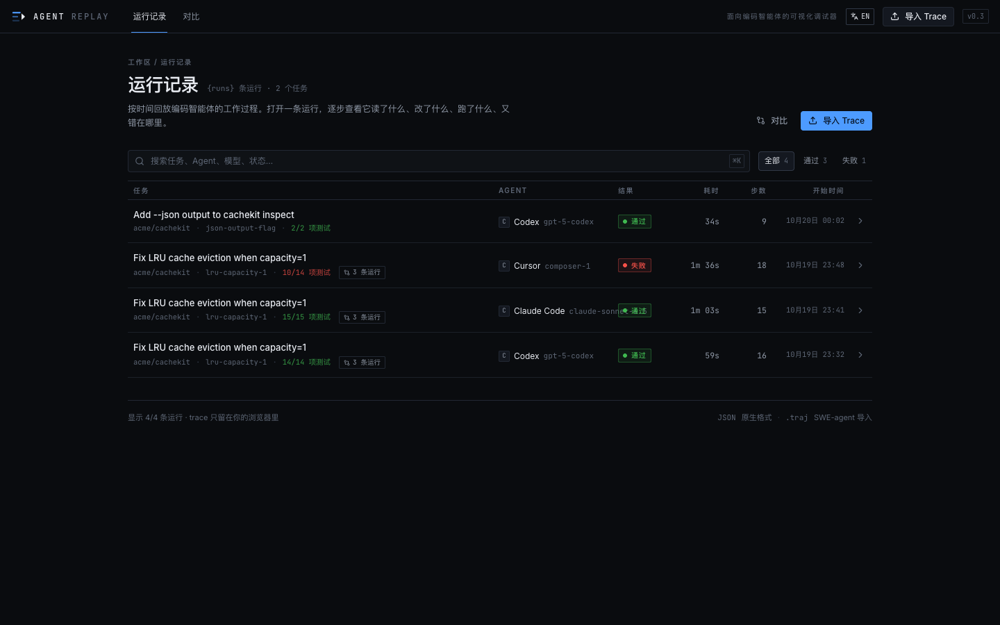
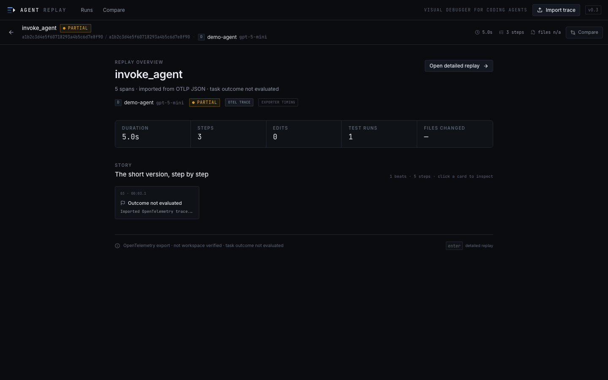

# Agent Replay

[English](README.md) | [简体中文](README.zh-CN.md)

**面向 Coding Agent 的可视化调试器：回放原生事件，并用工作区事实核对 Agent 的操作。**

Agent Replay 把一次编程任务变成可以播放、暂停和定位的时间线。你可以看到 Agent 如何阅读代码、修改文件、运行测试、遇到失败并恢复，也能检查这些步骤有多少得到了环境证据的支持。

核心是 `native events × environment truth`：Agent 上报的编辑与实际 git diff 分开记录，任务测试结果与进程结束原因分别表达。测试失败、供应商不可用和进程超时，各自保留自己的含义。



## 主要功能

| 功能 | 说明 |
|---|---|
| 录制 | 采集原生 CLI 事件、git 基线、文件变化、命令输出与测试结果 |
| 回放 | 在概览故事、Story 时间线和 Flame 视图之间切换，定位任意步骤 |
| 检查 | 查看代码、diff、终端、测试摘要、搜索结果、推理摘要和原始 span |
| 工作区 | 按时间查看文件的读取与编辑标记，以及对应内容变化 |
| 对比 | 将同一任务的多条运行轨迹放在共享时间轴上，比较结果与执行过程 |
| 导入 | 支持原生 `agent-replay/v1` JSON、SWE-agent `.traj` 和 OTLP JSON |
| 双语 | 英文与简体中文界面，首次跟随浏览器语言，顶部按钮可切换 |

选择一步会同步更新舞台、Inspector、播放游标和工作区。原生事件保留真实的并行与重叠关系；瞬时事件只增加视觉宽度，不移动时间戳。

界面翻译不会改写 trace 内容：span 名称、命令、路径、diff 和技术导入诊断保持原文。


## 快速开始

需要 **Node.js >= 22.12**。

```bash
npm ci
npm run dev
```

打开终端打印的地址。应用内置四条演示轨迹，浏览演示无需后端、API key 或 Agent 安装。

```bash
npm test          # schema、适配器、录制器、故事生成与界面翻译等测试
npm run lint
npm run build     # 类型检查、Web 构建和 CLI 打包
```

Web 应用和录制器可以独立使用。`npm run dev` 即可浏览演示和导入文件；`npm run build` 还会生成 `dist-cli/agent-replay.mjs` 与验证工具 `dist-cli/validate.mjs`。

首次访问按 `navigator.language` 选择语言。顶部的 `中文` / `EN` 按钮可覆盖默认值，并将选择保存到 `localStorage`。

## 录制真实会话

录制器结合两类证据：**Agent 原生事件**和**工作区事实**。它读取 CLI 暴露的事件，不注入 Agent 内部，也不读取隐藏思维链。

```bash
npm run build
npm link                 # 可选：将 agent-replay 加入 PATH
agent-replay --help
# 不使用 npm link 时：
npm run cli -- --help
```

### 原生采集

需要先安装、配置并登录对应的 Agent CLI。实际调用使用该 CLI 的模型与计费配置。

```bash
agent-replay record cursor   --name cursor-lru   -- "fix the LRU cache bug"
agent-replay record codex    --name codex-lru    -- "fix the LRU cache bug"
agent-replay record claude   --name claude-lru   -- "fix the LRU cache bug"
agent-replay record opencode --name opencode-lru -- "fix the LRU cache bug"
agent-replay record qoder    --name qoder-lru    -- "fix the LRU cache bug"
agent-replay record zcode    --name zcode-lru    -- "fix the LRU cache bug"
agent-replay open cursor-lru
```

| Agent | 事件来源 | 真机证据 |
|---|---|---|
| OpenCode | `opencode run --format json` 的工具事件和原生时间 | 已验证 |
| Claude Code | `assistant` 的 `tool_use` 与 `user` 的 `tool_result` | 已验证 |
| Qoder CLI | 兼容 Claude 的流式消息 | 已验证 |
| ZCode CLI | 执行结束后读取 session-store 的 `part` / `tool_usage` | 已验证 |
| Codex | `codex exec --json` 的 item 事件 | 已验证 |
| Cursor | `tool_call started/completed` 与 `call_id` | 有适配器和 fixture，尚无真机录制 |

ZCode 从会话存储读取自身记录的时间，属于执行后读取的观测时间；缺少 `node:sqlite` 时退回仅工作区采集。Cursor 当前仍需交互式浏览器登录，因此其适配器的 fixture 覆盖不代表真机验证。

如果需要传递权限、模型或其他参数，可使用显式命令形式：

```bash
agent-replay record --adapter opencode --name opencode-lru -- \
  opencode run --format json --auto "fix the LRU cache bug"
```

各 CLI 的完整命令示例与版本说明见[英文 README](README.md#native-capture-recommended)。

### 被动录制

```bash
# 终端 1
agent-replay start --name lru-fix --agent Codex

# 终端 2：正常使用桌面 Agent，也可精确记录一次命令
agent-replay run -- pytest -q

# 回到终端 1
agent-replay stop
agent-replay open lru-fix
```

`start` 记录 git 基线并启动独立的工作区监听进程。它能观察磁盘上的变化与最终 diff；要获取原生工具调用，需要使用原生录制模式。

### 通用命令包装

```bash
agent-replay record --name any-agent -- <command...>
```

通用包装器记录 stdout/stderr，并尽力解析测试输出。`--tty` 可保留 TUI，但会关闭输出解析。录制需要 git 工作树；支持已有未提交改动的工作区，但最终 patch 可能包含录制前的改动。

## 采集可信度与时间

| `capture.fidelity` | 含义 |
|---|---|
| `native+workspace` | 原生工具事件，并用实际工作区 diff 核对编辑 |
| `native-events` | 仅原生事件，未观察工作区变化 |
| `wrapped-output` | 工作区事实与包装命令输出，工具语义依赖启发式解析 |
| `workspace` | 仅文件系统与 git 采集 |
| `otel` | 从外部 OTLP JSON 导入，无法提供工作区核验 |

时间标记为 `observed`、`estimated` 或 `mixed`。原生事件保留可获得的起止时间；SWE-agent 轨迹及包装输出里没有命令时间戳的测试使用估算时间，并明确标注。

`capture.integrity` 表达原生编辑声明与工作区证据的匹配情况。对同一文件的连续编辑按调用核对；失败的编辑调用单独记录，无工作区证据的成功编辑声明标记为 unverified。

测试 recall 使用 `parsedTestRuns / nativeTestRuns`。没有可匹配对象时不默认记成 100%。录制器不提供隐藏思维链、模型内部状态或供应商未暴露的费用数据。


## 任务验证与指标边界

验证工具在全新的 git 仓库里执行三类任务，并保存账本与 trace。先检查任务自身是否有效：

```bash
node dist-cli/validate.mjs --verify-tasks
```

每个任务必须满足“基线测试失败、覆盖 `reference/` 后全部通过”。Agent 结束后，harness 在最终工作树中独立运行任务验证命令，要求退出码为零、没有失败且至少有一项通过。受保护测试文件在验证前后都检查哈希；被修改时判为 `tests_modified`，执行前发现修改则不会运行验证命令。

账本分别记录任务结果 `taskResult`、结束原因 `termination`、可用性 `availability` 和采集完整性 `captureIntegrity`。供应商故障、CLI 缺失或未登录不会计为任务能力失败。

当前任务矩阵见 [`examples/validation/summary.json`](examples/validation/summary.json)：

| Agent | 运行次数 | 任务通过 | 干净完成的延迟中位数 | Trace 覆盖 | 编辑 recall | 测试 recall |
|---|---|---|---|---|---|---|
| OpenCode / glm-5.3-flash-free | 9 | 8 | 46.0s | 8/9 | 13/13 | 9/9 |
| Codex 0.163.0 | 1 | 1 | 38.4s | 1/1 | 1/1 | 2/2 |

OpenCode 有一次在 240s 超时，测试仍失败，且录制器被终止前未写出 trace。其任务失败保留在账本中，完整性为 `null`；recall 只基于另外八条有 trace 的运行。**8/9 的 trace 覆盖率与有 trace 部分的 100% recall 必须一起阅读。**

延迟是端到端墙钟时间，包含网络、供应商排队、Agent 编排与工具执行，不代表纯模型推理速度。汇总分成所有运行、成功任务、成功且进程正常完成三类。重试保留旧 attempt，汇总取每组运行的最新 attempt。

矩阵中的 Claude 调用要求显式 `--allow-paid`；Cursor 的登录要求单独记入可用性。历史真实 CLI 录制与免费模型采集矩阵见[英文 README](README.md#real-cli-validation)，这些小样本用于验证采集链路，不构成模型排名。

## 导入格式

### 原生 trace

`agent-replay/v1` 使用扁平的 `spans[]` 和可选的 `parentId`，包含任务、Agent、结果与定时事件。示例：

- [原生示例](examples/native-sample.trace.json)
- [包装输出示例](examples/recorded-sample.trace.json)
- [Claude 真机录制](examples/real-claude.trace.json)
- [OpenCode 真机录制](examples/real-opencode.trace.json)
- [Codex 真机录制](examples/real-codex.trace.json)

Span 类型包括 `agent`、`generation`、`reasoning`、`read`、`search`、`edit`、`shell`、`test`、`browser`、`tool`、`unknown`、`checkpoint`、`final`。完整结构由 [`src/schema/trace.ts`](src/schema/trace.ts) 定义。

### SWE-agent `.traj`

在导入对话框中选择内置示例，或导入自己的 `.traj` 文件。适配器将 ACI 命令映射为读取、搜索、编辑、测试和提交步骤，从 observation 中解析测试结果，并生成明确标为估算的时长。提交后的轨迹保持 `partial`，因为轨迹文件不包含基准评估结论。

示例：[`examples/swe-agent-sample.traj`](examples/swe-agent-sample.traj)。

### OpenTelemetry / OTLP JSON

导入离线 `ExportTraceServiceRequest` JSON。一个文件包含多个 traceId 时，每条分别导入，并在对话框中列出。

- **精确时间**：纳秒时间戳要求十进制字符串，先用 BigInt 相减，再转换为毫秒。1 ns 差值与零时长均保留；数值类型时间戳直接拒绝，避免使用 JSON 已舍入的数据。
- **保留层级**：保留父子 ID、父节点选择和并行分行。十六进制 ID 匹配忽略大小写；缺父时保留悬空引用并给出诊断，循环父链与非法 ID 拒绝导入。
- **保守语义**：仅按 `gen_ai.operation.name` 与精确 `tool.name` 白名单识别类型，其余为 `unknown`。单独存在 provider/model 不推断为生成调用。
- **不推断任务成败**：OTel 状态映射为 `ok` / `error` / `unset`，trace 保持 `partial`，不生成任务结束结论。普通 `passed`、`failed`、`total` 属性不会变成测试故事；显式 test artifact 仍可展示。
- **保留原始上下文**：嵌套 AnyValue、bytes、混合数组、事件、链接，以及 resource/scope 对象保留在原始数据中；每条 trace 只引用自己使用的 resource。
- **明确证据来源**：界面显示 `OTEL TRACE` 与 exporter 时间，不将外部导入表述为经过工作区核验的录制。



范围限于离线 OTLP JSON；不支持 protobuf、gRPC、JSONL 或 collector。已做一份 Node SDK 真实 exporter 冒烟，尚未逐框架实测 OpenAI Agents、LangGraph、OpenInference、Phoenix；无时钟偏移检测，`localStorage` 容量也尚未评估。OpenAI Agents 分页外层需要先自行提取 `data[].otlp.resourceSpans`。

详细契约：[`docs/M5_OTEL_CONTRACTS.md`](docs/M5_OTEL_CONTRACTS.md)。测试样例与来源：[`examples/otel/`](examples/otel/)。

## 演示与对比

内置四条演示：Codex 与 Claude Code 修复 LRU 淘汰问题、Cursor 的失败尝试，以及 Codex 为 `cachekit inspect` 添加 `--json` 的功能任务。演示数据与真实录制的证据范围不同；Cursor 演示不代表已完成 Cursor 真机验证。

打开 Compare，将三条 LRU 轨迹放到同一时间尺度上。


## 架构

| 路径 | 职责 |
|---|---|
| `cli/index.ts` | `start/stop/run/record/open/list` 命令入口 |
| `cli/adapters/` | 各 Agent 事件流转换为统一 `AgentEvent` |
| `cli/lib/eventMerger.ts` | 匹配工具调用与工作区事实 |
| `cli/lib/traceBuilder.ts` | 生成统一 trace |
| `cli/validation/` | 任务验证、账本与派生指标 |
| `src/schema/trace.ts` | Zod schema 与语义约束 |
| `src/adapters/` | 原生、SWE-agent 与 OTLP 导入 |
| `src/store/` | 播放状态与本地导入数据 |
| `src/components/replay/` | 时间线、舞台、工作区、Inspector、播放器 |
| `src/i18n/` | 英文与中文文案、语言选择 |
| `src/pages/` | Runs、Replay、Compare 页面 |

UI 由数据驱动；适配器不直接构建 trace；播放共享一个时钟；Monaco 按需加载。演示、导入与 CLI 录制使用同一 schema 和 UI。应用无需后端，导入保存在浏览器本地，录制文件由本地 `agent-replay open` 服务提供。

## 当前状态与边界

M0–M4 的可视化、原生 schema、导入、对比与录制链路已实现；M4.8 的测量完整性与验证 harness 已收口；M5 已按离线 OTLP JSON 导入范围验收。Cursor 真机录制及上述 OTel 边界继续保留。

本项目用于理解和调试 Agent 完成任务的过程；不提供生产监控、托管模型调用、认证或数据库服务。不会记录隐藏思维链，仅展示产品公开提供的推理摘要。

完整计划见 [`PLAN.md`](PLAN.md)，变更记录见 [`CHANGELOG.md`](CHANGELOG.md)。

## 分享与本地数据

浏览导入与录制均在本地处理。录制写入 `replays/`，应用不自动上传 trace；被录制的 Agent CLI 仍按自身配置连接模型服务。

`node_modules/`、`dist/`、`dist-cli/`、`replays/` 与 `.agent-replay/` 已由 `.gitignore` 排除。分享源码压缩包时也应排除这些目录，由接收方运行 `npm ci` 和 `npm run build`。

Trace 可能包含代码、路径、命令与终端输出。手动分享自己的录制前，请检查其中是否有凭据或其他不宜公开的内容。
